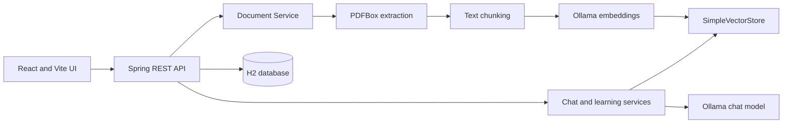

# CampusGPT

CampusGPT is a local-first academic learning assistant. It turns a student's PDF notes,
syllabi, handbooks, and course material into a searchable knowledge base, then uses retrieval-
augmented generation (RAG) to answer questions with relevant document sources.

The project is designed for students who want one private study workspace instead of repeatedly
searching through large PDFs. It also provides summaries and automatically generated multiple-
choice quizzes so the same material can support reading, revision, and self-assessment.

## Why This Project Exists

Academic information is often spread across lecture notes, regulations, calendars, and reference
documents. Generic chatbots may answer confidently without using the student's actual material.
CampusGPT addresses that problem by indexing uploaded documents and instructing the assistant to
ground answers in retrieved passages. The local Ollama setup keeps documents and model requests
on the user's machine and avoids a required paid API subscription.

## Use Cases

- Ask questions about lecture notes and receive answers grounded in uploaded sources.
- Find dates, rules, definitions, and requirements in a long academic calendar or handbook.
- Upload several course PDFs and keep them available for later sessions.
- Generate a concise document summary with key concepts and examination points.
- Generate exam-style multiple-choice questions for revision.
- Review document and conversation activity from the dashboard.
- Demonstrate a complete local RAG pipeline for learning, prototyping, or a software project.

## Features

### Document management

- Upload PDF files through the web interface.
- Extract selectable text page by page with Apache PDFBox.
- Split text into overlapping chunks for retrieval.
- Index chunks in Spring AI's in-memory `SimpleVectorStore`.
- View document status, file metadata, and processing errors.
- Delete documents and reindex existing documents.

### Grounded assistant

- Ask questions from the AI Assistant page.
- Retrieve the most relevant document chunks using semantic similarity.
- Return source filenames, pages, and excerpts with grounded answers.
- Keep chat sessions and messages in the local H2 database.
- Apply a deterministic calendar-answer path for supported academic-calendar queries.

### Learning tools

- Generate summaries from extracted document text.
- Generate one to twenty MCQs from an indexed document.
- Parse both structured JSON quiz output and a text fallback format.
- Select answers and reveal explanations in the quiz interface.

### Local administration

- Dashboard counters for total and indexed documents and conversations.
- Settings page showing the active API and Ollama configuration.
- Health endpoint for checking backend availability.
- CORS configuration for the local Vite frontend.

## Technology Stack

- Backend: Java 21 source level, Spring Boot 3.5, Spring AI, Spring Data JPA, H2, PDFBox
- Local AI: Ollama with `llama3.2:3b` for chat and `nomic-embed-text` for embeddings
- Frontend: React, Vite, TypeScript, Axios, React Markdown, Lucide icons
- Storage: H2 file database in `backend/data`, uploaded PDFs in `backend/uploads-local`
- Tests: JUnit 5, Spring Boot test support, Vitest, TypeScript compiler

## Architecture



## Requirements

- Java 21 or a compatible newer JDK
- Node.js 20 or newer and npm
- Ollama running locally for embeddings, chat, summaries, and quizzes
- Windows, macOS, or Linux
- No Docker, PostgreSQL, pgvector, or OpenAI API key is required for the local profile

## Setup

### 1. Install Ollama models

Install Ollama from [ollama.com/download](https://ollama.com/download), then run:

```powershell
ollama pull llama3.2:3b
ollama pull nomic-embed-text
ollama list
```

Ollama normally listens on `http://localhost:11434`.

### 2. Configure optional environment values

Copy the root example file if you need to change defaults:

```powershell
Copy-Item .env.example .env
```

Important variables include:

| Variable | Default | Purpose |
| --- | --- | --- |
| `BACKEND_PORT` | `8081` | Spring Boot HTTP port |
| `FRONTEND_ORIGIN` | `http://localhost:5173` | Allowed browser origin |
| `OLLAMA_BASE_URL` | `http://localhost:11434` | Ollama server URL |
| `OLLAMA_CHAT_MODEL` | `llama3.2:3b` | Chat model name |
| `OLLAMA_EMBEDDING_MODEL` | `nomic-embed-text` | Embedding model name |
| `UPLOAD_DIR` | `./uploads-local` | Uploaded PDF directory |
| `CHUNK_SIZE` | `2600` | Chunk size used for indexing |
| `CHUNK_OVERLAP` | `350` | Overlap between chunks |
| `RETRIEVAL_TOP_K` | `3` | Number of chunks retrieved per question |
| `SIMILARITY_THRESHOLD` | `0.45` | Minimum retrieval similarity |

The frontend reads `frontend/.env` when present. Set `VITE_API_BASE_URL` if the backend is not
using the default port:

```text
VITE_API_BASE_URL=http://localhost:8081/api
```

### 3. Start the backend

From the repository root, use the bundled Maven installation on Windows:

```powershell
Set-Location .\backend
..\apache-maven-3.9.9\bin\mvn.cmd spring-boot:run
```

On macOS or Linux, use an installed Maven 3.9+ command:

```bash
cd backend
mvn spring-boot:run
```

Verify the backend from another terminal:

```powershell
curl.exe http://localhost:8081/api/health
```

Expected response:

```json
{"status":"UP","service":"CampusGPT"}
```

### 4. Start the frontend

In a second terminal:

```powershell
Set-Location .\frontend
npm install
npm run dev
```

Open [http://localhost:5173](http://localhost:5173) in a browser.

## How to Use the App

1. Open **Documents** and upload a text-based PDF.
2. Wait for the document status to become **INDEXED**. The first upload may be slow while
    Ollama creates embeddings.
3. Open **AI Assistant** and ask a question about the indexed material.
4. Inspect the returned source filenames, pages, and excerpts.
5. Open **Quiz**, choose an indexed document and question count, then generate revision questions.
6. Select an option and use **Show answer** to reveal the correct answer and explanation.
7. Use **Dashboard** to review counts and recent activity.
8. Use **Settings** to confirm the API and local AI model configuration.

## API Endpoints

| Method | Endpoint | Purpose |
| --- | --- | --- |
| GET | `/api/health` | Check service health |
| GET | `/api/dashboard` | Load dashboard statistics |
| POST | `/api/documents/upload` | Upload and index a PDF |
| GET | `/api/documents` | List documents |
| GET | `/api/documents/{id}` | Get one document |
| DELETE | `/api/documents/{id}` | Delete a document |
| POST | `/api/documents/{id}/reindex` | Reindex a document |
| POST | `/api/documents/{id}/summary` | Generate a summary |
| POST | `/api/chat/sessions` | Create a chat session |
| GET | `/api/chat/sessions` | List chat sessions |
| GET | `/api/chat/sessions/{id}/messages` | List session messages |
| DELETE | `/api/chat/sessions/{id}` | Delete a chat session |
| POST | `/api/chat/ask` | Ask a grounded question |
| POST | `/api/quiz/generate` | Generate a quiz |

## Development and Tests

Backend tests:

```powershell
Set-Location .\backend
..\apache-maven-3.9.9\bin\mvn.cmd test
```

Frontend tests and production build:

```powershell
Set-Location .\frontend
npm test -- --run
npm run build
```

The tests cover text chunking, prompt safety and metadata, and quiz parsing. Live AI behavior
requires Ollama and is intentionally not required for unit tests.

## Troubleshooting

- **The UI shows red API errors:** check `http://localhost:8081/api/health`, then refresh the
   frontend. Both services must be running.
- **The backend does not start:** use the repository-bundled Maven command shown above and check
   that Java 21 or newer is available.
- **Ollama connection refused:** start Ollama and confirm both models appear in `ollama list`.
- **A document is FAILED:** use a PDF with selectable text. Scanned PDFs are not supported because
   OCR is not implemented.
- **Answers are slow:** reduce the document size or use a smaller Ollama chat model such as
   `llama3.2:1b` through `OLLAMA_CHAT_MODEL`.
- **Port 8081 is busy:** change `BACKEND_PORT` and set the matching `VITE_API_BASE_URL`.
- **Data needs to be reset:** stop the backend and remove the local H2 files under `backend/data`
   and uploaded files under `backend/uploads-local`.

## Limitations and Privacy

- Only PDF files are accepted.
- Scanned PDFs require OCR, which is not currently included.
- The vector store is in memory and is rebuilt from indexed documents when the backend starts.
- H2 and uploaded files are local development storage, not a production backup strategy.
- Local Ollama requests keep inference on the configured machine, but users should still protect
   their local files and environment configuration.
- Generated answers and quizzes can be incorrect; verify important academic information against
   the cited source documents.

## Project Structure

```text
backend/       Spring Boot API, services, persistence, PDF and RAG pipeline
frontend/      React and Vite user interface
docs/          Architecture, API, database, RAG, and viva documentation
sample-documents/  Example materials for local testing
```

## License

No license has been declared yet. Add a license before distributing the project publicly.
